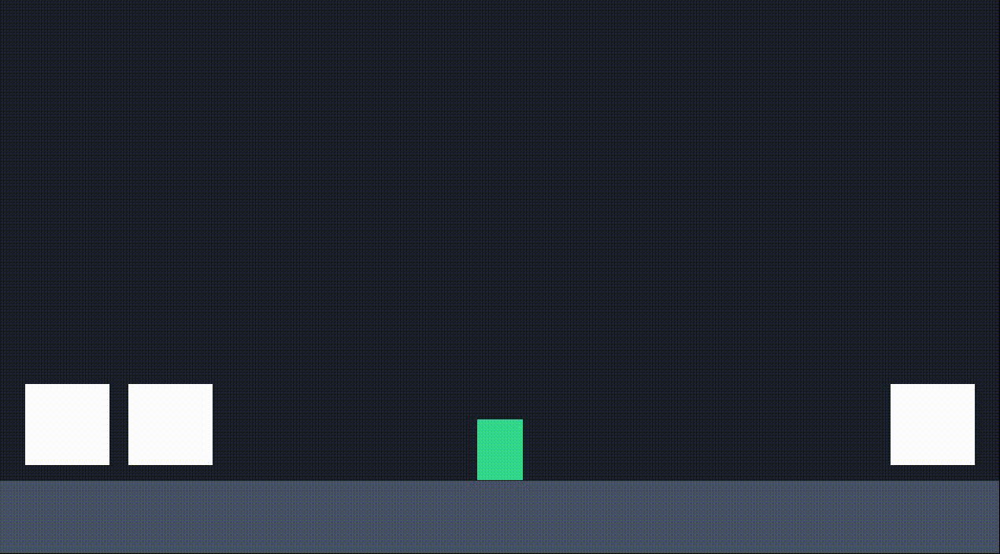

# 2D Physics Mechanics Demo

Standalone 2D physics and collision mechanics demonstration built with **libGDX** and **Box2D**, featuring procedural geometry, movement and jump controls, falling dynamic bodies with automatic lifecycle cleanup, and dual **Desktop** + **Android** support.

## Features & Technical Highlights

- **Box2D Physics & Collisions:** Fixed-timestep simulation with contact tracking, responsive horizontal movement, and jump mechanics.
- **Dynamic Spawning & Cleanup:** Spawns dynamic geometric bodies with automatic removal after their lifetime expires to keep simulation and memory predictable.
- **Desktop & Android Controls:** Supports keyboard controls on desktop and touch controls on Android.

## Running the Project

1. Clone the repository and import the Gradle project into your IDE (IntelliJ IDEA or Android Studio).
2. Run the **Desktop** application or build and install the **Android** target.

## License

This project is licensed under the MIT License. See the [LICENSE](LICENSE) file for details.

## Hire Us

Need custom 2D physics gameplay systems, reliable collision handling, or end-to-end 2D game production?

- **Email:** info@amphotericstudio.com
- **Commercial Deck (PDF):** `[Commercial Deck PDF — Coming Soon]`
